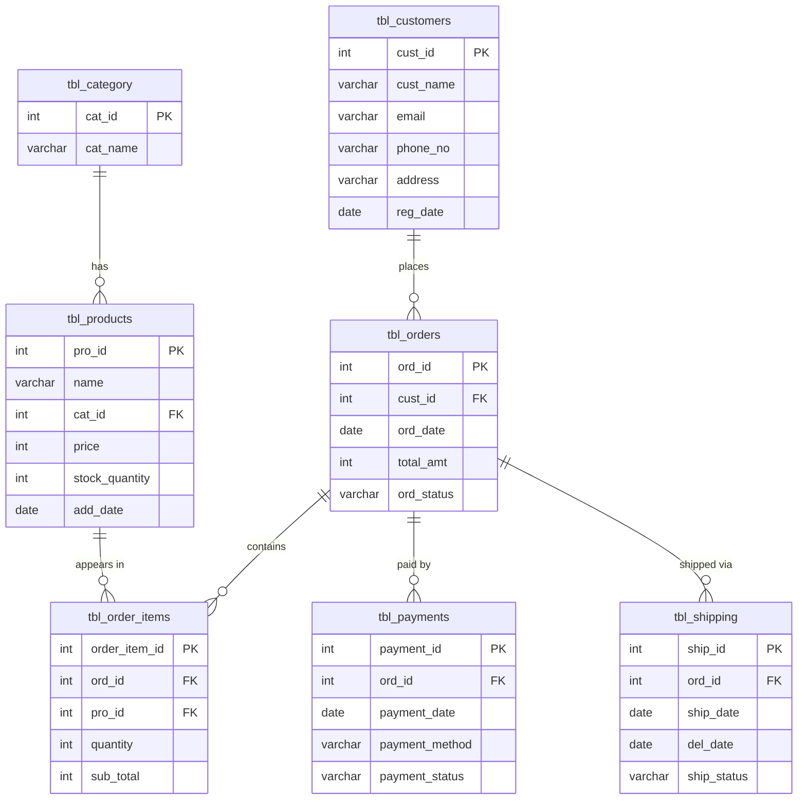

# 🛒 E-Commerce Order Management System (MySQL)

A relational database project that models the core of an online store: categories, products, customers, orders, order items, payments, and shipping. It includes the schema, sample data, and a set of SQL queries covering everything from basic CRUD to joins, subqueries, window functions, and `CASE` expressions.

---

## 📌 Table of Contents

- [Overview](#overview)
- [Tech Stack](#tech-stack)
- [Database Schema](#database-schema)
- [Table Descriptions](#table-descriptions)
- [Getting Started](#getting-started)
- [Queries Covered](#queries-covered)
- [Sample Queries](#sample-queries)
- [Notes](#notes)
- [Project Structure](#project-structure)
- [Author](#author)

---

## Overview

This project builds a database named `exam_db` for an e-commerce order management system. It lets you:

- Store and organize products by category
- Track customers and their order history
- Record order line items, payments, and shipping status
- Run reporting queries on revenue, top customers, best-selling products, delivery times, and more

---

## Tech Stack

| Component | Details |
|-----------|---------|
| Database  | MySQL 8.0+ |
| Language  | SQL |
| Tools     | MySQL Workbench / MySQL CLI / any MySQL client |

> Window functions (`RANK()`, `SUM() OVER`) and CTEs (`WITH`) require **MySQL 8.0 or later**.

---

## Database Schema



---

## Table Descriptions

| Table | Purpose |
|-------|---------|
| `tbl_category` | Product categories (Electronics, Clothing, Books, etc.) |
| `tbl_products` | Product catalog with price, stock, and the date it was added |
| `tbl_customers` | Customer details and registration date |
| `tbl_orders` | Order header: customer, date, total amount, and status |
| `tbl_order_items` | Line items linking orders to products with quantity and subtotal |
| `tbl_payments` | Payment method and status for each order |
| `tbl_shipping` | Shipping date, delivery date, and shipping status for each order |

---

## Getting Started

### Prerequisites

- MySQL Server 8.0+
- A MySQL client (MySQL Workbench, CLI, DBeaver, etc.)

### Setup

1. **Clone the repository**
   ```bash
   git clone https://github.com/MaahroofMunshi01/<your-repo-name>.git
   cd <your-repo-name>
   ```

2. **Run the SQL script**

   Using the MySQL CLI:
   ```bash
   mysql -u root -p < ecommerce_order_management.sql
   ```

   Or open the `.sql` file in MySQL Workbench and execute it.

3. **Select the database**
   ```sql
   USE exam_db;
   ```

4. **Verify the setup**
   ```sql
   SHOW TABLES;
   SELECT * FROM tbl_products;
   ```

---

## Queries Covered

| # | Topic | What it demonstrates |
|---|-------|----------------------|
| 1 | Insert, Update, Delete | Loading sample data, reducing stock after a sale, deleting old cancelled orders |
| 2 | Filtering & Sorting | Orders from the last 6 months, top 5 most expensive products, customers with more than 3 orders |
| 3 | Logical Operators & Set Operations | `AND`, `NOT`, `IN`, and `UNION` for combining conditions |
| 4 | Sorting & Grouping | `ORDER BY`, `GROUP BY`, orders per customer |
| 5 | Aggregate Functions | Total revenue, best-selling product, average order value |
| 6 | Basic Reports | Listing orders and payments |
| 7 | Joins | `INNER`, `LEFT`, `RIGHT`, and `FULL OUTER JOIN` (emulated with `UNION`) |
| 8 | Subqueries | Customers registered after 2022, top spender, products never ordered |
| 9 | Date & Time Functions | Orders per month, delivery time with `DATEDIFF`, formatting dates as `DD-MM-YYYY` |
| 10 | String Functions | `UPPER`, `TRIM`, `COALESCE` / `NULLIF` for missing emails |
| 11 | Window Functions | `RANK()`, cumulative monthly revenue, running order count |
| 12 | `CASE` Expressions | Customer loyalty tiers and product sales categories |

---

## Sample Queries

**Top 5 most expensive products**
```sql
SELECT * FROM tbl_products
ORDER BY price DESC
LIMIT 5;
```

**Customers with more than 3 orders**
```sql
SELECT cust_id, cust_name
FROM tbl_customers
WHERE cust_id IN (
    SELECT cust_id
    FROM tbl_orders
    GROUP BY cust_id
    HAVING COUNT(ord_id) > 3
);
```

**Delivery time in days**
```sql
SELECT ord_id, ship_date, del_date,
       DATEDIFF(del_date, ship_date) AS delivery_days
FROM tbl_shipping
WHERE del_date IS NOT NULL;
```

**Rank customers by total spending**
```sql
SELECT c.cust_id, c.cust_name,
       SUM(o.total_amt) AS total_spent,
       RANK() OVER (ORDER BY SUM(o.total_amt) DESC) AS spending_rank
FROM tbl_customers c
JOIN tbl_orders o ON c.cust_id = o.cust_id
GROUP BY c.cust_id, c.cust_name;
```

**Loyalty status using `CASE`**
```sql
SELECT c.cust_id, c.cust_name,
       COALESCE(SUM(o.total_amt), 0) AS total_spent,
       CASE
           WHEN COALESCE(SUM(o.total_amt), 0) > 50000 THEN 'Gold'
           WHEN COALESCE(SUM(o.total_amt), 0) BETWEEN 20000 AND 50000 THEN 'Silver'
           ELSE 'Bronze'
       END AS Loyalty_Status
FROM tbl_customers c
LEFT JOIN tbl_orders o ON c.cust_id = o.cust_id
GROUP BY c.cust_id, c.cust_name;
```

---

## Notes

- `phone_no` is stored as `VARCHAR(15)` (changed from `INT`) so that 10-digit mobile numbers fit.
- Some sample rows use `CURDATE()`, so results of date-based queries (for example, "last 6 months" or "older than 30 days") depend on the day you run the script.
- MySQL has no `FULL OUTER JOIN`, so it is emulated using `LEFT JOIN ... UNION ... RIGHT JOIN`.
- Sample data is for learning and demonstration only.

---

## Project Structure

```
.
├── ecommerce_order_management.sql   # Schema, sample data, and all queries
└── README.md                        # Project documentation
```

---

## Author

**Maahroof Munshi**
GitHub: [@MaahroofMunshi01](https://github.com/MaahroofMunshi01)

---


